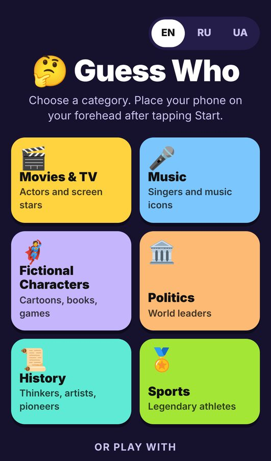
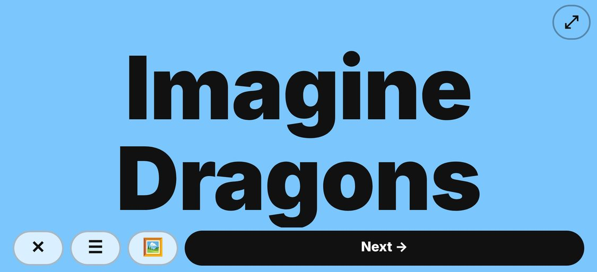
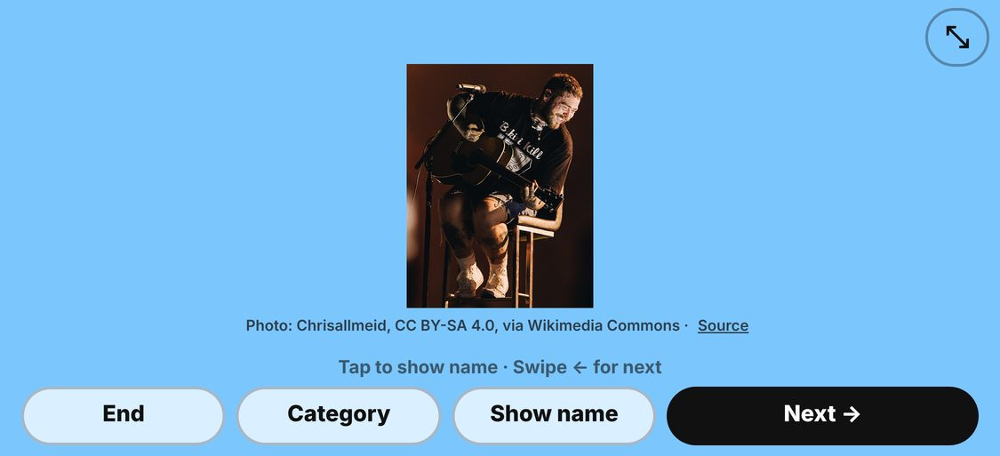
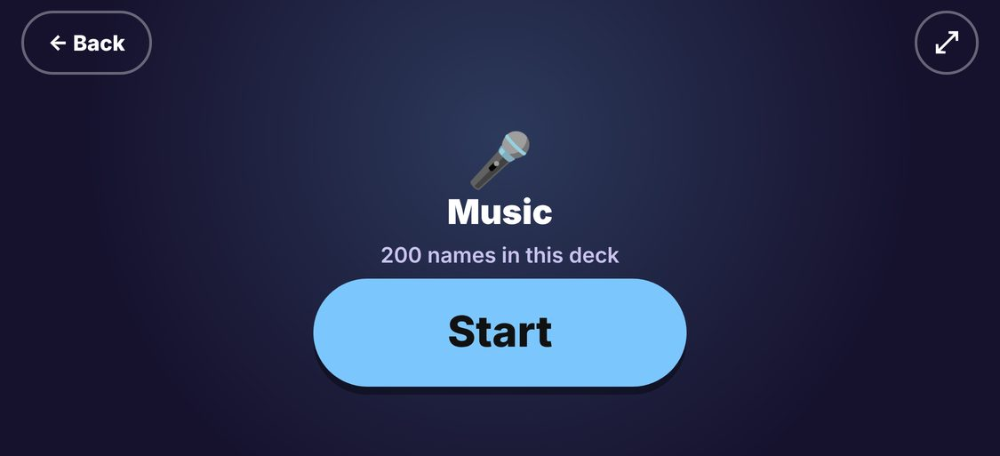
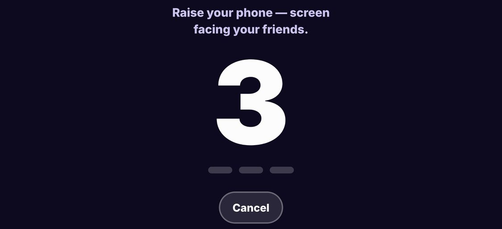
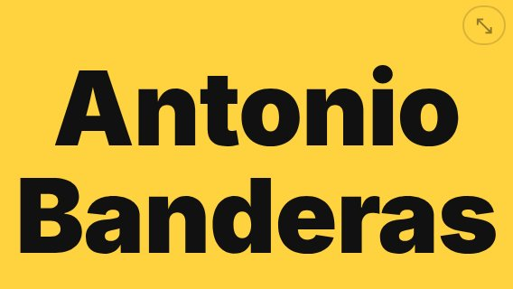

# 🤔 Guess Who

**Play now → [guesswhogame.vercel.app](https://guesswhogame.vercel.app)**

A party game for phones. Put your phone on your forehead and ask yes/no questions
until you guess who you are. No app, no sign-up: everyone just opens the site.

<p>
  
  
  
</p>

## How to play

1. Pick a category: **Movies & TV, Music, Fictional Characters, Politics, History,
   Sports**, **Mix** (all of them) or **Custom word** (a friend types one in).
2. Tap **Start**, then hold the phone **sideways** on your forehead, screen facing
   your friends. A 3-second countdown gives you time.
3. Ask yes/no questions. The name stays on screen until someone moves on.
4. **Swipe ←** (or **Next**) for a new name, **swipe →** to go back to the previous one.
   **Tap** the card to switch between the name and a photo.

<p>
  
  
</p>
<p>
  
</p>

## Features

- **949 people and characters everyone knows**: only names an ordinary person in any country would recognise, 100–214 per category.
- **Photos for 929 of 949 names.** Real people come from Wikimedia Commons under free
  licenses. Cartoon and film characters use the copyrighted image from their Wikipedia
  article, credited to the owner. Every photo shows its credit and a link to its source.
- **English, Русский, Українська**: interface and names. The language follows the
  browser and can be switched on the home screen.
- **No repeats in a session.** A name you've already seen won't come up again in any
  category, Mix included, until that category runs out.
- **No peeking.** Every new or previous name appears after a countdown. If the screen
  locks while a name is shown, unlocking gives you another countdown first.
- **Built for landscape.** On Android, Start goes fullscreen and locks the screen
  sideways. The screen stays on during play.
- **Nothing in the way.** In fullscreen you see only the card, so you play with swipes
  and taps. A small button exits fullscreen and brings the controls back.
- Static site with no backend, accounts or tracking. The only network requests are
  the photos, and only when you tap for one.

## Development

Requires Node.js 20.19+.

```bash
npm install
npm run dev        # local dev server
npm run check      # content validation, lint, types, tests, production build
```

The character bank is generated. Edit the lists in [`content-source/`](content-source),
then rebuild:

```bash
npm run content:images   # look up licensed photos for new names (Wikimedia Commons)
npm run content:locales  # look up Russian / Ukrainian names (Wikipedia)
npm run content:build    # regenerate src/content/characters/*.json
```

Details: [`src/content/characters/README.md`](src/content/characters/README.md).

## Deploy

The site is hosted on Vercel (project `guess-who`, settings in [`vercel.json`](vercel.json)).
Every push to the production branch deploys automatically, and other branches get
preview URLs. To deploy by hand, run `npx vercel deploy --prod`.

## Tech

Vite, React 19 and TypeScript, tested with Vitest and Testing Library. The specs are
in [`docs/`](docs), and the build history is in [`IMPLEMENTATION_LOG.md`](IMPLEMENTATION_LOG.md).

Photos belong to their authors. People's photos are public domain, CC0, CC BY or
CC BY-SA. Character images are copyrighted by their owners (Disney, Pixar, Warner
Bros. and others) and are shown only for identification in this personal,
non-commercial game. Nothing here implies endorsement.
